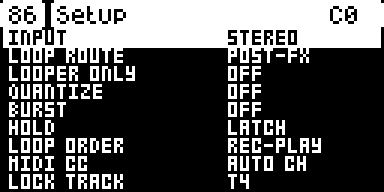

# DigiCosm

An effects engine for the Digitone mk1's two audio inputs, after the
[Hologram Microcosm](https://www.hologramelectronics.com/pages/microcosm):
eleven engines with four variations each, a 60-second looper, Hold, Reverse,
a resonant filter, pitch modulation and a reverb with four rooms, all in
time with the Digitone's tempo, and the Microcosm's MIDI CCs. DigiCosm is an
elekloader mod for core-dn1 3.2. It is not affiliated with Hologram
Electronics and uses none of its code; the engines are rebuilt from the
Microcosm's public manual.

DIGICOSM is an entry in core-dn1's Mod Menu (hold a track key). While its
page is open, DigiCosm owns the audio engine (core-dn1 3.2's `core_audio`):
the synths are silent, the Digitone's own effects are off, and everything
you hear is the inputs through DigiCosm. NO gives the audio and the screen
back. The sequencer keeps running, so DigiCosm follows its tempo and PLAY,
STOP and TEMPO still work.

**DigiCosm 0.1.1 is a pre-release.** 0.1 runs on a Digitone mk1, and 0.1.1
was checked in digikit's emulator ([digiemu](https://github.com/irpina/digiemu))
on OS 1.43 and 1.44. Its source is also in elekloader
([mods/digicosm-dn1](https://github.com/irpina/elekloader/tree/main/mods/digicosm-dn1)),
with the core it needs. 0.1.1 fixes a mono input: with SETUP's INPUT on MONO,
the dry and every engine come out of both sides, centred (0.1 kept them on
the left, and some engines leaned to one side).




## Install

You need:
- **elekloader from its main branch,** with Python 3.9 or newer (see
  [its README](https://github.com/irpina/elekloader#install)). DigiCosm keeps
  26 MB of buffers in the Digitone profile's `bulk` area, which elekloader
  has had since core-dn1 3.2 (on main) but its app releases do not have yet:
  the 0.4.0 app refuses DigiCosm (*"region digicosm buffers
  0x44000000-0x45b00000 is outside every free area"*).
- **This mod and its core,** from
  [this repository's releases](https://github.com/irpina/digicosm/releases):
  `digicosm-0.1.1.elemod` and `core-dn1-3.2.elemod` for OS 1.43, or
  `digicosm-0.1.1-os1.44.elemod` and `core-dn1-3.2-os1.44.elemod` for 1.44.
  DigiCosm needs core-dn1 3.2: exclusive audio, the MIDI CC event, the
  tempo and the stock pages' fonts. No elekloader release has it yet:
  install it from here until one does.
- **The stock OS file:** `Digitone_and_Digitone_Keys_OS1.44.syx` or
  `..._OS1.43.syx`, from
  [Elektron's Digitone downloads](https://www.elektron.se/support-downloads/digitone).
  elekloader recognises the file by its hash.

Build your OS on the command line (or in elekloader's window, run from
source: **+ Install from file...** both files, tick **digicosm**, and make
sure the core ticked with it is **core 3.2**):

```bash
python -m elekloader.patch --stock Digitone_and_Digitone_Keys_OS1.44.syx \
    --mod core-dn1-3.2-os1.44.elemod --mod digicosm-0.1.1-os1.44.elemod \
    --out Digitone_OS1.44-digicosm.syx --version DC01
```

`--version` is the 4 characters the unit will show. Flash the `.syx` with
Elektron Transfer, as for any OS update: connect the unit over USB, select
it in Transfer and **Connect**, drag the `.syx` onto **Drop files here**,
and press **YES** on the unit. Don't turn it off until the upgrade is done.

**Recovery:** elekloader never changes the bootloader, so the stock OS
file always restores the unit. Hold **FUNC** while powering on for the
startup menu, and press **TRIG 4** for OS UPGRADE. Then send the stock
`.syx` with Transfer.

**Opening it:** hold a track key on its own for the Mod Menu, then press
trig key 1 (or YES) on DIGICOSM. The first time after power-on it shows
"DIGICOSM..." for a moment while it clears its buffers. NO closes it and
gives the synths back.

## The page

DigiCosm's page is drawn like the Digitone's own parameter pages, in their
fonts: the tempo in the box at the top left, the engine and variation in the
title bar with the page number (1/3), the looper's state (and the H, R and B
of Hold, Reverse and Bypass when they are on) and the input's meter on the
left, and eight controls, one per knob: a knob, a value box or a switch.
While you turn a knob, the title bar shows its value. LEFT and RIGHT, or
PAGE, move between the three pages; holding FUNC shows page 2.

| Page | Knobs A-D | Knobs E-H |
|---|---|---|
| 1 Effect | ACT, REP, SHP (its contour), FLT | MIX, TIME, SPC, LOOP |
| 2 Shift (the Microcosm's Shift + a knob) | GAIN (input, 64 is 0 dB; the - and + knob), MDEP, MRAT (pitch modulation), RESO | FXVL (effect volume), LSPD (loop speed), VERB (room), FADE (loop fade) |
| 3 Looper | HOLD, REV, BYP: turn right for on, left for off, or push | LOOP (record, play, overdub), STOP, UNDO, CLR: push |

Pushing a knob on pages 1 and 2 sets it back to its default. Time picks a
bar, 1/2, 1/4, 1/8, 1/16 or 1/32 of the Digitone's tempo, and when the
sequencer plays the engines' grid is its timeline.

| Microcosm | DigiCosm |
|---|---|
| The preset selector | trig keys 1-11 pick the engine, 13-16 the variation (A-D) |
| Hold | HOLD on page 3, or trig key 12 (latching, or momentary in SETUP) |
| Looper footswitches: Rec / Play / Dub, hold for undo; Stop, hold to erase | page 3, or T1 and T2 as the two footswitches (hold T1 to undo, T2 to erase) |
| Reverse, Bypass (with trails) | REV and BYP on page 3 |
| 16 user presets | FUNC + trig key 1-16 recalls one; in SETUP a trig key saves the page as that preset (the engine, the variation and knobs A-H). They are saved with the project |
| Global configuration | YES opens SETUP (input mono/stereo, loop route, looper only, quantize, burst, hold mode, loop order, MIDI channel); UP and DOWN pick a row, LEFT or RIGHT changes it |
| MIDI CCs | the same CC numbers, on the Digitone's auto channel (see MIDI below) |
| Tap tempo | the Digitone's own tempo (TEMPO) |

## MIDI

While DigiCosm's page is open, it takes the Microcosm's CCs that come on the
Digitone's auto channel (MIDI CONFIG > CHANNELS > AUTO CHANNEL), through
core-dn1 3.2's `ev_midi_cc`; with SETUP's MIDI CC on ANY CH it takes them on
a track's channel too. The Digitone does not apply a CC DigiCosm takes; every
other CC, and every CC while the page is closed, goes on to the Digitone.
MIDI CONFIG > PORT CONFIG > INPUT FROM has to let them in (MIDI, USB or
both).

| CC | | CC | |
|---|---|---|---|
| 5 | Subdivision (Time), in steps: 0-5 | 18 | Loop Speed in steps: 0-5 |
| 6 | Activity (A) | 19 | Mod Depth (FUNC + B) |
| 7 | Shape (C) | 20 | Space type (FUNC + G) |
| 8 | Filter (D) | 21 | Loop Fade (FUNC + H) |
| 9 | Mix (E) | 23, 47 | Reverse: on from 64 |
| 10 | Time (F) | 24-27 | SETUP's loop route (PRE-FX), looper only, burst, quantize: on from 64 |
| 11 | Repeats (B) | 28 | Record: starts a loop, closes it, or starts a new take |
| 12 | Space (G) | 29 | Play: closes a recording, restarts a stopped loop, ends an overdub |
| 13 | Loop Level (H) | 30 | Overdub, on and off |
| 14 | Mod Rate (FUNC + C) | 31 | Stop |
| 15 | Resonance (FUNC + D) | 34, 35 | Erase, undo |
| 16 | Effect Volume (FUNC + E) | 48 | Hold: on from 64 |
| 17 | Loop Speed (FUNC + F) | 102 | Bypass below 64, on from 64 |

CC 5 and CC 18 take the Microcosm's steps, 0 to 5: 1/4, 1/2, TAP, 2x, 4x
and 8x (anything above 5 as 8x). The six subdivisions are DigiCosm's six
Time steps, a bar down to 1/32; the loop speeds are its five, 1/4X to 4X,
with 8x as 4X. The looper's CCs act on a value of 64 or more.

CC 22 (looper on/off), 45 and 46 (copy and save preset) and 93 (tap tempo)
have nothing to do here: the looper is always on, presets are saved from
SETUP and the tempo is the Digitone's. DigiCosm takes them anyway while it
is open, so they don't change the active track's sound. Program changes (the
Microcosm's preset recall) are not mapped: core-dn1 passes DigiCosm the CCs
only.

## Engines

| | Engine | A | B | C | D |
|---|---|---|---|---|---|
| 1 | MOSAIC: loops at several speeds | 1x and 2x | 1x and 0.5x | all 2x | 0.5x, 1x, 2x, 4x |
| 2 | SEQ: slices shuffled into rhythms | filtered | 1x and 0.5x (a pad at full Activity) | layers with filter sweeps | layers, crushed |
| 3 | GLIDE: loops whose speed glides | 0.5x-1x | 2x-0.5x | 1x-2x | up and down at once |
| 4 | HAZE: grain clouds | stretched | random | 1x and 2x | 1x and 0.5x |
| 5 | TUNNEL: micro-loop drones | the loop breathes | an octave down, swept | resonant band-passes | the input moves the loop |
| 6 | STRUM: repeats of note onsets | the last onset | copies phasing | a cascade of onsets | a cascade and 2x grains |
| 7 | BLOCKS: rearranged blocks | with bursts | pitched | filtered, soft | pitched and crushed |
| 8 | INTERRUPT: bursts in place of the dry | rearranged | pitched | filter sweeps | crushed |
| 9 | ARP: onsets as arpeggios | 1x | thirds, fifths, octaves | a filter a step | crushed |
| 10 | PATTERN: taps of a delay | straight | syncopated | clusters | triplets |
| 11 | WARP: taps, processed | envelope filters | resonant band-passes | pitched | 2x grains |

Activity is density (loopers, grains, taps, steps), Repeats how long or
how often (a loop's life, a drone's decay, a delay's feedback), and Shape
the contour of each loop or grain: FLAT, SWEL(l), PERC, ARCH. The
Microcosm does not publish what its macros move in each variation, so these
are DigiCosm's own.

## How it works

Every engine is a scheduler that starts *heads*: readers of a 10.9-second
history of the input, interpolated and windowed, as one-shot grains or as
loops. PATTERN reads taps off a delay line of its own. After the engine come
the looper (60 s stereo, with one overdub layer for undo), pitch modulation,
the filter, Space (an eight-line feedback delay network) and Mix against the
dry input. Everything is fixed point in C (`dsp.c`), at interrupt level in
core-dn1's render; the UI (`ui.c`) runs in the Digitone's UI task.

- **Memory:** the buffers (26 MB) are a region in the Digitone profile's
  `bulk` area (`resources.regions` in `mod.json`), cleared when DigiCosm
  first opens. The code and its state take 30 KB of the 128 KB mods share.
- **CPU:** DigiCosm times its own render with DMA timer 0 and shows its share
  of a block in the corner (`C`). Over 45% it starts fewer new grains; under
  30% it allows more again, up to sixteen heads.
- **Project data:** the page (engine, variation, knobs, FUNC's knobs, SETUP)
  and the sixteen presets are saved with the project (tag `DCSM`, 132 bytes:
  a preset keeps the knobs at 6 bits). Mods share 480 bytes there;
  digitables' tables take 328 of them, and DigiCosm fits beside them. Loops
  are not saved.

## Build

With elekloader's SDK (from its main branch) and a stock OS file:

```bash
python -m elekloader.sdk.build path/to/digicosm --stock Digitone_and_Digitone_Keys_OS1.43.syx   # digicosm-0.1.1.elemod
python -m elekloader.sdk.build path/to/digicosm --stock Digitone_and_Digitone_Keys_OS1.44.syx   # digicosm-0.1.1-os1.44.elemod
```

It names no firmware address, so its 1.44 port is empty. It needs core-dn1
3.2 (`"resources": {"core": "3.2"}`; its page uses 3.2's `fw_font_label` and
`fw_font_title`) and an elekloader with the profile's
`bulk` area. `gentables.py` makes `tables.h`.

## Checked

0.1 runs on a Digitone mk1, with core-dn1 3.2; 0.1.1 changes only the mono
input, checked in the emulator. In digikit's emulator, OS 1.43 and 1.44, in
detail:

- **Owning the audio.** With the factory pattern playing, its FM is silent
  while DigiCosm is open and back at once after NO, also when PLAY was
  pressed while DigiCosm was open. After DigiCosm has used its buffers, the
  FM plays as before.
- **The page.** Its three pages, laid out pixel for pixel as the stock
  FLTR, AMP and LFO pages (their labels on the same rows, in the same
  font); a knob turn and its value in the title bar; FUNC's view; page 3's
  switches, turned and pushed, and its looper boxes (record, play, stop,
  clear); the engine and variation keys; SETUP and NO; as screenshots and as
  the state DigiCosm keeps. T3 and T4 do nothing now.
- **The engines.** Every engine at every variation, with plucked notes on
  the inputs, on the emulator's cycle clock (MCF5441x tables at 250 MHz):
  each makes sound, at the octaves its variation names (MOSAIC C an octave
  up, MOSAIC D down, at and up; HAZE C and D; GLIDE's ranges; WARP C's
  pitched taps), and the whole render, the stock part included, takes
  30-55% of a block, never more than stock's 56.6%. DigiCosm's own reading
  agrees with the cycle clock (HAZE at full Activity: 39%, sixteen heads).
- **The looper.** Record, play, overdub (a fifth over the loop), undo (the
  fifth gone), reverse, stop with its fade, and erase.
- **Hold.** MOSAIC and HAZE keep sounding with the input silent while Hold
  is on, and fall silent once it is off.
- **Mono input (0.1.1).** With SETUP's INPUT on MONO and white noise on the
  left input only, the dry and the bypassed signal come out of both sides
  at the same level (in 0.1 they stayed on the left), and every engine's
  effect is centred: over 5 s, right against left between 0.87 and 1.07,
  except BLOCKS and INTERRUPT, whose random placements average out over
  longer. MOSAIC, TUNNEL, PATTERN and WARP used to lean to one side (down
  to 0.62) and now spread their voices evenly.
- **Presets.** A page saved as preset 5 from SETUP comes back exactly with
  FUNC + trig 5 after the engine, variation and knobs have changed; an
  empty preset changes nothing. The page and its presets fit in the
  project beside digitables' tables.
- **MIDI.** CCs sent into the emulator's MIDI input on 1.43 and 1.44: while
  the page is open, the mapped ones on the auto channel set DigiCosm (the
  knobs, CC 5 and 18 in the Microcosm's steps, FUNC's knobs, Reverse, Hold,
  Bypass, SETUP's rows, and the looper through record, play, overdub, stop
  and erase) and do not reach the Digitone's own CC handling, nor do CC 22,
  45, 46 and 93; an unmapped CC, a CC on a track's channel (with AUTO CH)
  and every CC while the page is closed go on to it. With ANY CH a track's
  channel works too.
- **The Digitone Keys.** With the Keys bit set in the emulator, core-dn1 3.2
  hands the inputs left first as on a Keys and keeps the Keys' own output
  buffer silent. Nothing has run on a Keys.

## Not yet

- Saving loops. The Digitone's +Drive is not a file system but a fixed
  store of slots (a project slot is 4 MB, the 128 of them from 256 MB on,
  with other regions below and above), so a mod has no file to write, and
  no part of the card is known to be free. Loops stay in memory and are
  lost at power-off.
- Program changes: the Microcosm recalls presets with them, but core-dn1
  has no event for them.
- An expression pedal (the Digitone Keys has an input for one).
- A run on a Digitone Keys: only the code path was checked, in the
  emulator.

## Licence

GPL-2.0-or-later. See LICENSE.
